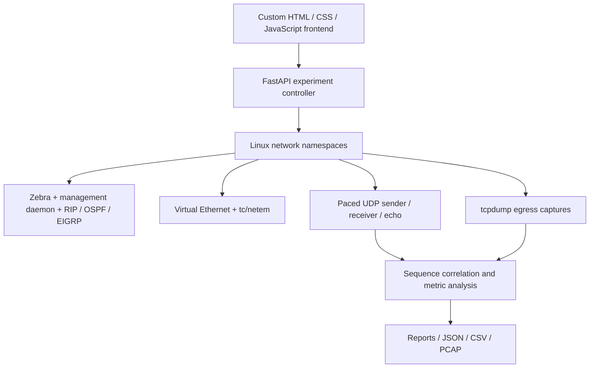

# CN-Sim

**Comparative Performance Analysis of RIP, OSPF, and EIGRP Routing Protocols**

A custom white web workspace for building networks, running real routing software, following captured packets, and comparing measured performance. The frontend is written specifically for this project. It controls isolated Linux routers running FRRouting; routing and packet forwarding are not simulated in JavaScript.

## Run it

1. Start **Docker Desktop** (macOS/Windows) or Docker Engine (Linux).
2. From this folder, run:

   ```sh
   ./start.sh
   ```

3. Open **[http://127.0.0.1:8000](http://127.0.0.1:8000)**.

The initial build downloads the Linux image, FRRouting and network tools. Subsequent starts reuse the image. Node.js, Python and package installation are **not required on the host to use the application**. All runtime dependencies are in the container. Fonts are bundled, so the interface works offline after the image is built.

Stop with `./stop.sh`. Completed results remain in the Docker data volume. Starting the service again restores those results; the live virtual network is created afresh.

Equivalent commands:

```sh
docker compose up -d --build --wait
docker compose down
```

The service binds to loopback only. The lab container needs privileged mode to create its own network namespaces and virtual Ethernet links; it does not mount the Docker socket or use the host network.

For a hosted domain, use the authenticated HTTPS gateway in
[the EC2 deployment guide](deploy/README.md) and `compose.production.yaml`.

## What is implemented

- **Topology editor:** add/move routers and hosts, connect devices, delete connections/devices, undo, zoom, import/export topology JSON, and automatically save drafts in the browser.
- **Link configuration:** bandwidth, one-way delay, random loss and link state. tc/netem applies rate, delay and loss per direction.
- **Real routing:** independent `zebra`, `mgmtd` and protocol daemon processes in each router namespace. RIPv2, OSPFv2 area 0 and EIGRP AS 100 are supported. FRRouting **10.7.1** is pinned from its official signed package repository.
- **Network inspection:** current kernel routes, protocol neighbor/status output, generated configuration, real ping and ICMP traceroute.
- **Experiments:** one protocol or all three, repeat trials, choose traffic endpoints/rate/payload/duration, select a timer profile and schedule a link failure. Trials run sequentially and later trials rotate protocol order.
- **Live observations:** deployment/convergence progress, packet counters, route changes, failures and experiment event stream.
- **Packet inspector:** search/filter the probe ledger, select a sequence number, animate its captured egress path, inspect one-way delay/RTT, view routing transmissions and download per-device PCAPs.
- **Reports:** protocol comparison, circular green/yellow/red scores, delay and goodput charts, mean ± sample standard deviation for repeated trials, route/config inspection and an in-app methodology page.
- **Exports:** full result JSON, packet CSV, comparison JSON, PCAPs and print-to-PDF report layout.
- **Persistence:** completed result JSON and PCAPs live in the named Docker volume; topology/settings live in browser storage. Background jobs can be stopped, and cancelled trials are excluded from report averages.

**Observed EIGRP limitation:** the tested FRR daemon learns routes and forwards steady-state traffic, but can retain stale next hops after a link failure in the bundled redundant topology. Such runs show a warning and leave unconfirmed recovery unavailable. This is a result of the tested implementation, not a general conclusion about EIGRP. Read [KNOWN_LIMITATIONS.md](KNOWN_LIMITATIONS.md) before using failure results to rank protocol specifications.

## Suggested demonstration

1. Use the bundled six-router, two-host topology. The upper route has faster links; the lower route provides redundancy.
2. Select **Compare all**, source **PC1**, destination **PC2**, 25s, 20 packets/s and a 512-byte payload. Start with **no scheduled failure**.
3. Run the comparison. Each protocol first gets a fresh network and must learn complete routes and remain stable for three seconds. Startup time is measured separately from traffic.
4. Open **Packet inspector**, select a packet and inspect the actual egress observations. Download a PCAP to examine protocol messages in Wireshark.
5. Open **Report**. Compare raw metrics before interpreting the circles. Use two or three trials to display variation.
6. Run a separate failure experiment, for example disconnecting R2–R4 (L3). Explain the difference between data-plane recovery and complete routing-table convergence, including the FRR EIGRP limitation when observed.
7. Export JSON/CSV and print the report for the project submission.

Keyboard shortcuts: **V** select/move, **C** connect, **Delete** remove selection, **Ctrl/Cmd+Z** undo. End hosts have one router connection. Editing link conditions requires redeployment; manual disconnect/reconnect applies immediately to an unchanged deployed topology.

## Architecture



One Docker Linux environment contains the controller and separate network stacks for each device. Hosts have a directly connected interface and a default gateway. Routers receive loopback addresses in `10.255.0.0/24`; each link gets its own `10.0.N.0/30` subnet. Only the selected protocol is enabled for each experiment. Configuration is applied through FRR's management/VTY interfaces, not hand-written routing tables.

## Measurement definitions

| Measurement | Definition |
|---|---|
| Delivery/loss | UDP sequence IDs generated by the sender versus unique IDs recorded by the receiver; local send errors are also reported |
| One-way delay | Receiver arrival minus sender timestamp using the shared Linux monotonic clock |
| RTT | Echo arrival minus send timestamp, reported independently from one-way delay |
| Delay variation | Mean absolute difference between consecutive delivered probes' one-way delays |
| Payload goodput | Delivered application payload bytes × 8 / traffic duration; excludes network headers |
| P95 delay | Nearest-rank 95th percentile of delivered probe delays |
| Routing overhead | RIP/OSPF/EIGRP IPv4 bytes and packet transmissions observed once at each virtual link's egress |
| Data bytes | Probe and echo IPv4 egress bytes at the same boundary as routing overhead |
| Startup convergence | Last observed route-table change after first-router startup, followed by 3s stable and complete routes |
| Failure route convergence | Last observed change after link failure, followed by at least 2s stable and complete routes |
| Data-plane recovery | Start of the first complete 1s send-time window after failure with all expected probes delivered |

Tables are sampled approximately every **0.5s**, so convergence estimates have that sampling uncertainty plus controller overhead. Readiness checks route presence to graph-reachable endpoint addresses; chosen-flow delivery and tracing independently check forwarding. The sender allows a two-second drain period. A missing observation is displayed as **—**, never substituted with zero.

Charts group packets by their **send-time second** and show the last trial per protocol. Repeated-trial tables show mean ± sample SD. Missing metrics are excluded from their metric mean and the observation count is shown; cancelled trials are excluded entirely.

### Timer policy

| Profile | RIP update / timeout / garbage | OSPF hello / dead | EIGRP hello / hold |
|---|---|---|---|
| Lab | 5 / 30 / 20 s | 1 / 4 s | 1 / 4 s |
| Standard | FRR defaults, typically 30 / 180 / 120 s | Defaults, typically 10 / 40 s | Defaults, typically 5 / 15 s |

A common profile is a common experimental policy, not an assertion that protocol mechanisms are identical. Administrative carrier loss is distinct from neighbor timeout. Exact generated configurations are included in each full JSON export.

OSPF cost is `max(1, floor(100 / bandwidth_Mbps))`. EIGRP interface bandwidth is set in kbps and its configured delay metric is `max(1, round(delay_ms × 100))` ten-microsecond units. Actual link shaping is separate from routing metrics.

### Circular scores

These are **project-defined summaries**, not standardized protocol efficiency percentages:

```text
D = delivered / generated × 100
L = 100 / (1 + mean_one_way_ms / 50)
C = 100 / (1 + convergence_seconds / 2)
E = data_egress_bytes / (data_egress_bytes + routing_egress_bytes) × 100

Overall = 0.40D + 0.20L + 0.25C + 0.15E
```

Failure runs use failure route convergence for C; other runs use startup convergence. Missing convergence/delay yields zero for that score component. Trial scores are averaged. **Green ≥80, yellow ≥60, red <60.** Interpret raw metrics and implementation warnings alongside every score.

## Development and verification

Use the development mount configuration for edits without rebuilding the image:

```sh
docker compose -f compose.yaml -f compose.dev.yaml up --build
```

Restart `lab` after Python changes. Frontend changes appear on browser refresh. No frontend build step is needed.

```sh
# Backend input validation, capture parsing and measurement tests
docker compose exec -T lab python3 -m unittest discover -s tests -p 'test_*.py' -v

# Frontend score and escaping checks (Node 18+ on host)
node --test tests/frontend.test.mjs

# Actual protocol runs: startup, captures, failure outcomes and steady-state delivery
python3 tests/integration.py

# API guards, exports, cancellation, partial measurements and teardown
python3 tests/api_edges.py

# Disposable independent three-router routing proof
docker compose run --rm lab python3 -m backend.smoke
```

The integration test explicitly checks for a warning when EIGRP does not recover; it does not assert successful EIGRP failover or treat it as a healthy protocol result. It independently validates steady-state forwarding for all three implementations and alternate-path recovery for RIP/OSPF. GitHub Actions runs the unit/frontend and real-routing integration checks on pushes.

Browser QA also covers topology addition/connection/undo, protocol controls, deployment, packet selection, report rendering and downloadable observations. Tests generate their own experiments; development summaries under `artifacts/` are ignored by Git.

## Source layout

| Path | Responsibility |
|---|---|
| `dist/` | Custom frontend, local fonts and sample topology |
| `backend/models.py` | Bounded input and topology validation |
| `backend/lab.py` | Namespaces, interfaces, tc/netem, daemon lifecycle and diagnostics |
| `backend/controller.py` | Job lifecycle, convergence checks, trials and persistence |
| `backend/probe.py` | Real paced UDP sender / receiver / echo |
| `backend/capture.py` | Classic PCAP and cooked/Ethernet IPv4 parsing |
| `backend/analysis.py` | Delivery, timing, overhead and trial aggregation |
| `backend/app.py` | Local HTTP API and frontend serving |
| `tests/` | Unit, integration and API lifecycle checks |

The API is documented at [`/docs`](http://127.0.0.1:8000/docs). Mutating API requests require `X-CN-Sim: 1` and same-origin browser requests; the application accepts only localhost hostnames. There is one active network and one background job at a time.

If startup fails, inspect `docker compose logs`. Router logs, PCAPs and result JSON are under `/data` in the container. Rebuild after pulling changes with `./start.sh`. This application is intended for a local lab, not a shared public server.

Fonts: DM Sans and IBM Plex Mono, bundled under the SIL Open Font License; license files are in `dist/fonts/`.
